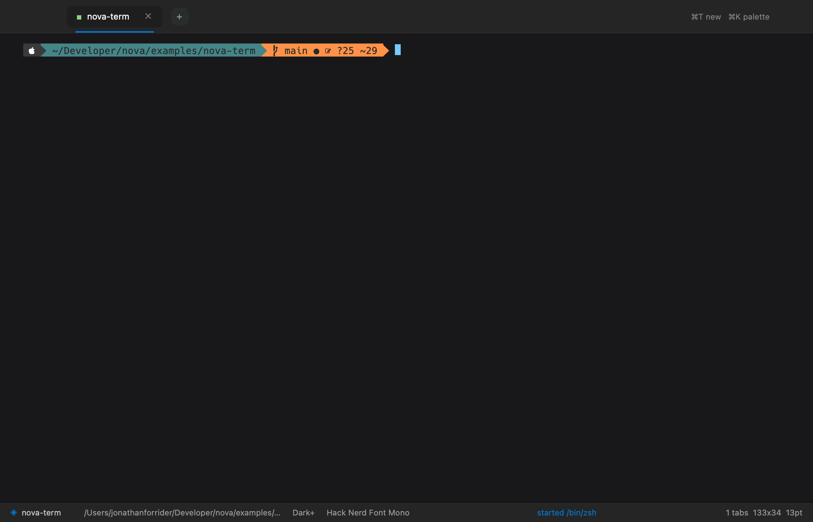

**Status: experimental, macOS only.** `examples/nova-term` is a standalone terminal emulator written in Nova on [nova-gui](../../libraries/gui/). The pty lives in the host, the escape-sequence parser lives in `libraries/nova-term`, and the window is drawn cell by cell by Nova itself. There is no Electron, no web view and no ncurses.



## Run it

Build with the current Nova tool, not the checked-in bootstrap:

```sh
cd examples/nova-term
../../examples/nova-tool/target/nova/nova-tool build
NOVA_TERM_ROOT="$PWD" ./target/nova/nova-term
```

To install the app bundle with its icon:

```sh
sh examples/nova-term/install-macos.sh
```

The installer builds, renders `packaging/icon.html`, writes `NovaTerminal.icns`, ad-hoc signs, copies `Nova Terminal.app` to `/Applications` (or `~/Applications`) and writes a `nova-term` launcher to `~/.local/bin`.

| Variable | Meaning |
|---|---|
| `NOVA_TERM_ROOT` | Folder new tabs start in. Defaults to the logged-in user's home directory. |
| `NOVA_TERM_SCRIPT` | Runs a scripted UI test, then exits (see [Tests](#tests)). |
| `NOVA_TERM_SHOT` | Writes the first frame to a PNG and exits. |
| `NOVA_MONO_FONT` | Overrides the monospaced family. Defaults to an installed Nerd Font. |
| `NOVA_PTY_TRACE` | Appends the raw bytes read from each pty to a file, for parser debugging. |

## What it does

- **Real pty tabs.** Each tab is its own pty slot in the host (eight available). The shell sees a terminal: it prompts, colours, reads keys and receives `SIGWINCH` when the window resizes. The child gets its own identity (`TERM=xterm-256color`, `TERM_PROGRAM=NovaTerminal`, `COLORTERM=truecolor`) instead of inheriting Warp/iTerm variables.
- **Typing and IME.** Plain keys arrive through AppKit's input context as composed UTF-8 text, then go straight to the active pty. The same path feeds the palette and search fields, so shifted, dead-key and composed characters work rather than only ASCII key codes.
- **Mouse and terminal queries.** A child can enable modes 1000, 1002 or 1003; left press/release, drag and wheel are sent as SGR (`1006`) or X10. Shift keeps local selection. DSR (`ESC[5n`/`6n`), primary/secondary DA and `ESC[18t` are answered from a reply queue; leaving the alternate screen clears a stale mouse mode.
- **ANSI / VT100 screen.** SGR colours (16, 256 and 24-bit), cursor addressing, erase, insert/delete line and character, scroll regions, save/restore cursor, tab stops, wrapping, the alternate screen (`ESC[?1049h`) and OSC window titles (BEL or `ESC \` terminated).
- **Scrollback.** 2000 lines per tab, wheel or `PageUp`/`PageDown`, `Cmd+F` searches it and marks each hit on the left edge.
- **Prompt blocks.** A 2px rail marks every prompt line (OSC 133 `A`, or a line beginning with `$`, `❯` or `%`), so commands are easy to find while scrolling.
- **Selection.** Click places the cursor, double-click selects a word, triple-click selects a line and dragging extends the selection; `Cmd+C` copies the selection when there is one, otherwise the screen.
- **Tab bar.** The first tab starts after the 92 px traffic-light inset, only the `+` control creates a tab, and pressing the empty strip drags the window.
- **Command palette.** `Cmd+K` filters *new tab, close tab, clear, copy, paste, find, theme, font, larger/smaller text, scroll to top/bottom*.
- **Themes and zoom.** Dark+ and Gruvbox palettes, 10–22pt text; the grid and the pty resize together.
- **Nerd Font by default.** The host picks an installed family named `… Nerd Font …` (override with `NOVA_MONO_FONT`), so Powerline and devicon glyphs draw instead of boxes. *Font: next monospaced family* in the palette cycles every installed monospaced family and the status bar names the one in use.
- **Copy and paste** through the system clipboard.

## Keys

| Action | Key |
|---|---|
| New tab / close tab | `Cmd+T` / `Cmd+W` |
| Select tab | `Cmd+1` … `Cmd+8` |
| Command palette | `Cmd+K` |
| Find in scrollback | `Cmd+F` |
| Copy selection / screen | `Cmd+C` |
| Paste | `Cmd+V` |
| Clear screen | `Cmd+L` |
| Larger / smaller text | `Cmd+` / `Cmd-` |
| Scroll | wheel, `PageUp`, `PageDown` |
| Close palette or search | `Esc` |

## Architecture

```
keyboard ──► input context ──► event_text ──► pty_write(slot) ──► /bin/sh -c "$SHELL"
                                                                    │
screen ◄── parse ◄── pty_poll(slot) ◄───────────────────────────────┘
```

- `runtime/gui.m` owns a pool of eight ptys: `nova_pty_open`, `nova_pty_poll`, `nova_pty_write`, `nova_pty_write_text`, `nova_pty_resize`, `nova_pty_close`, `nova_pty_status`. Each slot has a reader thread appending to a locked buffer; Nova polls it once per frame.
- `libraries/nova-term` is the emulator: a ring of rows (a linefeed copies one row, not the grid), a ring of scrollback lines, a VT parser and a renderer that batches same-colour runs into single draw calls.
- `tm_feed` keeps a pending register for a split UTF-8 scalar or an unfinished CSI/OSC sequence and parses it with the next pty read. Every feed ends at a clean parser boundary, so a read split in the middle of `ESC[K` cannot paint the final `K`, and a Nerd Font glyph split across reads still lands as one cell.
- The app is immediate mode: poll every live pty, feed the bytes, draw the grid, poll one event.

### The nova-term library

```nova
import "../libraries/nova-term/src/term.nova" as vt

var t = vt.tm_new(120, 30)
t = vt.tm_feed(t, gui.pty_poll(0))
vt.tm_draw(t, 16, 8, 1200, 640, 13, vt.tm_palette_dark())
```

`tm_feed` mutates the terminal in place and returns the same `Term`; store the return value because Nova passes structs by value. `tm_resize`, `tm_scroll`, `tm_all_text`, `tm_find`, `tm_cell_at`, `tm_key_text`, `tm_mouse_bytes`, `tm_take_reply` and `tm_palette_gruvbox()` cover the rest.

The parser needs raw Unicode scalars, so this work also added **`String.chars()`** to the language: unlike `graphemes()`, which glues ANSI sequences onto the following cluster for styled-text measurement, `chars()` returns one element per scalar and keeps escape bytes intact. `char_code()` turns a scalar back into an `Int`; `String.bytes()` is still used to detect a split sequence at a pty-read boundary.

## Tests

```sh
cd examples/nova-term
sh tests/term-ui.sh
```

The harness feeds synthetic ANSI through the real parser and drives the real pty: colour indices, cursor addressing, alternate-screen restore, 256-colour, `pwd` through a shell, tab create/close and OSC titles. It also pins the recent prompt regressions: a `BEL`-terminated OSC, a split U+E0B0 Powerline glyph and a split `ESC[2K`. New cases cover mouse SGR/X10 press, release, drag and wheel, alternate-screen view reset, DSR/DA/size replies, and the default home directory. The current run is **passed 47, failed 0**.

The scripted harness exercises the text handler directly; the actual AppKit `event_text` path is verified by typing a command into the installed app.

## Install as an application

```sh
sh examples/nova-term/install-macos.sh
```

Assembles `Nova Terminal.app` under `dist/`, copies it to `/Applications` (or `~/Applications`) and writes a `nova-term` launcher to `~/.local/bin` that opens the folder you run it from. The bundle is ad-hoc signed for local use, not notarized.

## Honest gaps

- **No splits or windows.** Tabs only; one window.
- **Mouse reporting is left-button only.** Right/middle buttons and a physical-click automation fixture are still missing; left press, release, drag and wheel are covered.
- **DCS is swallowed.** DSR/DA and text-area-size queries are answered; other device-control payloads are not.
- **No reflow on resize:** a narrower grid wraps new output, older lines keep their original break.
- **Scrollback is plain text**, so scrolled-off colour is lost.
- **Wide cells and emoji width** are not modelled; combining marks and double-width glyphs need work before this is a daily driver for every TUI.

## Performance, honestly

Input is drained before a frame is drawn, and a burst of keys is coalesced into one frame. A timestamped trace of the installed app recorded nine queued keys → nine pty writes in one millisecond and the first frame about 14 ms later; Enter echo was also about 14 ms. Steady-state frames cost 8–9 ms to draw and 2–3 ms to present on this machine. After a command, oh-my-posh can take ~200 ms to rebuild the prompt; that delay is shell-side.

The renderer is **CoreGraphics/CoreText into a CPU bitmap, not GPU/Metal**. A GPU glyph atlas is planned, not shipped. Compared with Warp it is a fraction of the feature set and has no AI. Compared with Ghostty it is not in the same performance class: Nova draws text through CoreText and re-renders in Nova code, whereas Ghostty uses Metal. What it does prove is that the language, the host and `nova-gui` are enough to build a working terminal.
