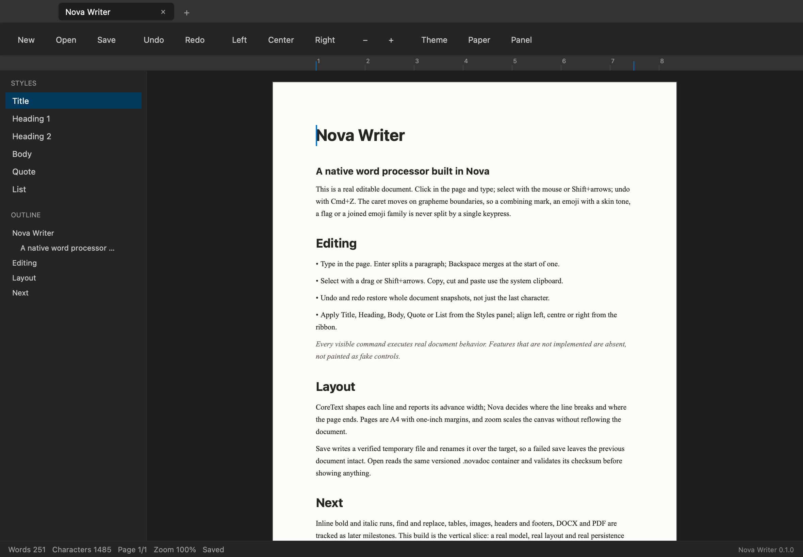

**Status: experimental, macOS only.** `writer/` is a word processor written in Nova on [nova-gui](../../libraries/gui/). The document model, measured line breaking, pagination, editing, persistence and recovery are Nova source; the only non-Nova code is the audited AppKit/CoreText host. There is no Electron, no web view and no `contenteditable`.



## Run it

```sh
# Build the compiler if needed
(cd examples/nova-tool && ../../bootstrap/nova build)

# Build and launch the app
(cd writer && ../examples/nova-tool/target/nova/nova-tool build)
writer/target/nova/nova-writer
```

Install a local bundle for testing:

```sh
sh writer/scripts/install-macos.sh
```

The installer builds, renders the icon, ad-hoc signs and copies `/Applications/Nova Writer.app`. It is not Developer ID signed or notarized.

## What it does

- **A real document model.** A versioned `Document` holds paragraphs with stable IDs, grapheme offsets, alignment, auto/LTR/RTL direction and non-overlapping inline run ranges. Insert, delete, split, merge and style changes are validated operations; edits return a new document.
- **Measured typography.** CoreText shapes and measures styled runs with per-glyph fallback; Nova decides where a line breaks and where a page ends. Paragraph direction drives alignment and caret geometry, and CJK text wraps without overflowing. Pages are A4 with one-inch margins, a ruler, zoom and visible-page virtualization.
- **Incremental layout.** A paragraph-level cache reuses measured lines by stable ID and content, so an edit reshapes only the changed paragraph before repaginating. A local 80-paragraph benchmark measured a one-paragraph edit at 56ms vs 2,265ms for a full relayout across 10 iterations.
- **Grapheme-aware editing.** The caret and deletion stop on extended grapheme clusters: combining marks, skin tones, flags and joined emoji families are never split by one keypress.
- **Selection, clipboard and undo.** Click/drag and Shift+arrows select; copy/cut/paste use the system clipboard; undo/redo restore bounded snapshots. The app stores serialized snapshots; the compiler now supports a `List<Document>` field, so it can switch later without changing behavior.
- **Styles and outline.** Title, Heading 1, Heading 2, Body, Quote and List have real metrics. The sidebar applies them and lists headings.
- **Inline bold and italic.** Bold/Italic toggle a selection or set the style for the next typed text. Run ranges survive insert, delete, split, merge, undo and save/reopen; layout measures and paints styled segments.
- **A checksummed native format.** `.novadoc` v4 is deterministic UTF-8 with a document language, per-paragraph direction, inline run records and a 31-based polynomial body checksum. Save writes a temporary file, verifies it and renames atomically; corrupt files, missing v4 fields and unknown versions are rejected with a line number. Version 1, 2 and 3 files migrate on load and are rewritten as v4 on save.
- **Autosave and crash recovery.** Dirty tabs are written atomically every four seconds under `~/Library/Application Support/Nova Writer/Recovery`. A crash leaves a valid `.novadoc`; the next launch restores up to six dirty tabs and says how many it recovered.
- **IME composition.** Marked text is painted inline through a temporary layout, underlined, and pushes the following text while the saved document stays untouched. Commit inserts the string exactly once; Escape clears the composition without inserting anything.

## Architecture

```
writer/src/main.nova                 native app: tabs, ribbon, pages, input
libraries/nova-document/src/
  text.nova                          grapheme segmentation and text edits
  document.nova                      versioned paragraphs, stable IDs, runs, undo
  layout.nova                        wrapping, paragraph cache, pagination, hit-testing
  store.nova                         .novadoc checksum and atomic save
  recovery.nova                      epoch-named autosave snapshots
runtime/gui.m + libraries/nova-gui   AppKit window, CoreText, files, clipboard
```

The app is immediate mode: draw the frame, pump the platform queue, handle one event. The document core is GUI-independent, so a future Nova Office app can reuse it without the window.

## Tests

```sh
sh writer/tests/core.sh       # 156 headless assertions
sh writer/tests/recovery.sh   # two-process crash recovery
sh writer/tests/ime.sh        # 14 IME commit/cancel assertions
sh writer/tests/smoke.sh      # real window + PNG snapshot
```

The IME test drives the same `NSTextInputClient` entry points AppKit uses (`setMarkedText:…` and `insertText:…`) through a host probe; a real Japanese/Chinese/Korean input source remains a manual check. The crash test writes unsaved work in one process, exits, then loads the recovery file in a second process. The smoke test launches the real window and writes a snapshot.

## Honest gaps

- No DOCX/ODT/RTF/HTML/PDF import or export.
- No tables, images, headers/footers, footnotes, sections or table of contents.
- Inline bold/italic is implemented; character styles, underline UI and list numbering are not.
- Inline runs are painted as separate CoreText segments, so kerning across a style boundary and mixed bidi plus inline styling are approximate.
- No native save panel: Save As uses the folder picker and a unique filename.
- No recovery prompt or discard command; startup restores every valid recovery file.
- No accessibility text ranges; the page has a label, not a screen-reader document model.
- Mixed-direction caret positions inside one line are approximate; CJK breaks are grapheme-based, not full UAX #14, and there is no hyphenation.
- One window and at most six visible tabs. Layout avoids reshaping unchanged paragraphs but still copies every line box during pagination; the cache is memory-only.
- Autosave rewrites the whole document every four seconds; there is no external-change detection or encryption.

These are tracked in `engineering/continuation/writer/BLOCKERS.md`, not hidden behind placeholder controls. Every visible command in the app executes real behavior; features that do not work yet are absent.

## Next

- [Nova GUI library guide](../../libraries/gui/)
- [Nova Terminal](../nova-term/)
- [Project status](../../status/)
